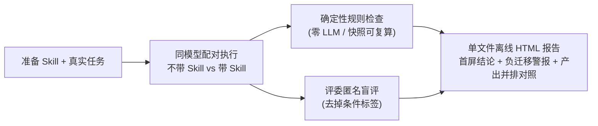

<div align="center">

# 大明 Skill 增益测评 (daming-skillgain)

**别凭感觉发 Skill —— 给 AI Agent Skill 加上发布前的自动化质检门禁**

[](https://github.com/dylanma8232-art/daming-skillgain/actions/workflows/ci.yml)
[](https://github.com/dylanma8232-art/daming-skillgain/releases/latest)
[](pyproject.toml)
[](LICENSE)
[](CONTRIBUTING.md)

**中文** | [English](README_EN.md) · [快速体验 Demo](#-30-秒快速上手) · [宿主接入指南](references/hosts.md) · [更新日志](CHANGELOG.md)

</div>

---

写了十几个 `SKILL.md`，却说不清它们到底有没有帮上忙？

- **第一次发布**：看起来很专业，但真的比不带 Skill 更强吗？
- **换个模型**：在 Claude 上很好用，换到小模型却触发**负迁移**（反而变差）？
- **改了一版**：微调了几句提示词，结果究竟变好了还是退化了？

**`daming-skillgain`** 是一个**Skill 发布前质检门禁**：在同一模型、同一真实任务下，自动化运行 **「带 Skill」与「不带 Skill」配对对照实验**，结合**确定性规则检查**与**匿名盲评**，产出单文件离线 HTML 报告，帮你用证据决定**发不发、在哪些模型上开、哪些模型上关**。

> 它专注衡量 Skill 的真实增益，不替你重写 Skill，也不是笨重的通用 Eval 平台。

---

## ⚡ 30 秒快速上手

### 1. 安装（支持 `skillgain` 全局命令）

```bash
pip install git+https://github.com/dylanma8232-art/daming-skillgain.git
```

<details>
<summary>或从源码 / Release 包安装</summary>

```bash
git clone https://github.com/dylanma8232-art/daming-skillgain.git
cd daming-skillgain
pip install -e .
```

也可直接到 [Releases](https://github.com/dylanma8232-art/daming-skillgain/releases/latest) 下载打包好的 Skill ZIP。

</details>

### 2. 零配置体验报告（无需 API Key，1 秒出图）

```bash
skillgain demo --open
```

无需任何密钥或配置，立即生成一份覆盖 **「明确有效 / 负迁移警报 / 测不出来」** 三种结论的自包含交互式 HTML 报告，所见即所得。

### 3. 检查本机可用 AI 工具并开测

```bash
skillgain doctor   # 一键体检：Python、依赖、本机 AI 工具与 API Key
skillgain simple   # 问答式引导：只答 4 个问题，自动跑完并生成 report.html
```

也可以直接用配置文件免交互一键跑通（适合 CI / 回归测试）：

```bash
skillgain pipeline --profile examples/eval-config.example.json
```

---

## 🎯 为什么选择 daming-skillgain？

| 维度 | 手动试跑凭感觉 | 通用 LLM Eval 框架 | **daming-skillgain** |
|---|---|---|---|
| 核心问题 | 看不出有没有用 | 测模型/Prompt 榜单 | **专测 Skill 真实增益（With vs Without）** |
| 负迁移检测 | 极易忽略 | 需自己写统计脚本 | **自动标红负迁移模型，明确建议关闭** |
| 证据不足处理 | 容易硬下结论 | 只给平均分 | **置信区间跨 0 时诚实报「测不出来」** |
| 确定性复核 | 无 | 需自行搭建 | **内置零 LLM 规则断言 + 快照可复算** |
| 报告交付 | 聊天记录截图 | 需起 Web 服务 | **单文件离线 HTML（零外链，直接发群里看）** |
| 接入成本 | 低但不可复现 | 高（需写 SDK/Dataset） | **问答式 4 步 / 5 行包装脚本接任意 Agent** |

---

## 🧭 三种诚实结论 & 测评流程

- ✅ **有效（Effective）**：证据支持启用 Skill 后结果更好，建议在该模型上开启。
- 🚨 **有害 / 负迁移（Harmful）**：证据支持结果变差，首屏红色警报，建议在该模型上关闭。
- ⚖️ **测不出来（Inconclusive）**：有效样本不足或波动过大，保留不确定性，绝不强行下结论。



---

## 📊 报告长什么样


- **结论先行**：首屏直接给出大字裁决、核心指标、红绿检查清单与负迁移警报。
- **并排交付物对照**：直接预览带 Skill 与不带 Skill 的真实产出文件（支持 Markdown / 表格 / 幻灯片等）。
- **100% 离线自包含**：CSS 与 JS 全内联、零外链，发给同事双击即可打开复核。

---

## 🔌 支持的 AI 工具与接入方式

被测工具本身**不需要安装任何插件**，评测器通过统一 `HostProtocol` 调度：

| 接入方式 | 支持工具 | 说明 |
|---|---|---|
| **内置原生适配器** | `opencode` / `claude-code` / `codex` / `cursor-agent` | 通过 `--host <name>` 直接选用；用 `skillgain doctor` 查看本机就绪状态 |
| **万能脚本契约** | Cursor / Trae / Windsurf / 通义灵码 / 任意 CLI Agent | 仅需 5~10 行包装脚本（见 [`examples/wrapper_template.py`](examples/wrapper_template.py)） |
| **直调模型 API** | `api` / `standalone` / `agent` | 适合纯文本生成任务；需文件操作能力时会在预检阶段明确提示 |

除 CLI 外，还内置 **Python SDK**、**REST API (`daming-skillgain[api]`)**、**MCP Server (`daming-skillgain[mcp]`)**，并自带 [`SKILL.md`](SKILL.md) 可直接作为 Agent Skill 安装调用。详见 [references/usage.md](references/usage.md)。

---

## 🛡️ 可信度与适用边界

- **确定性检查优先**：内置规则断言不调用 LLM；规则与结果均写入快照，支持用 `skillgain verify-snapshot` 独立复算。
- **不强下结论**：配对结论依据有效样本、差值、置信区间与证据门槛；不达标一律报「测不出来」。
- **匿名盲评**：评委只看到去除条件标识的实际交付物；评委意见作为证据之一保留原始记录，不冒充客观真值。
- **禁止跨宿主外推**：报告显式标注本次实际测过的工具、模型与任务；换工具或换任务应重新测评。

---

## 📁 项目示例与文档导航

- [`examples/sample-skill/SKILL.md`](examples/sample-skill/SKILL.md) — 开箱即用的示例 Skill
- [`examples/eval-config.example.json`](examples/eval-config.example.json) — 免交互一键测评配置模板
- [`examples/wrapper_template.py`](examples/wrapper_template.py) — 接入任意 CLI Agent 的脚本适配器模板
- [`references/workflow.md`](references/workflow.md) — 高级分步流水线（`plan` → `run` → `evaluate` → `report`）
- [`references/hosts.md`](references/hosts.md) — 宿主能力矩阵与接入说明
- [`references/host-protocol.md`](references/host-protocol.md) — 新增原生宿主适配器的开发协议

---

## 🤝 参与贡献

欢迎提交 Issue、分享你的 Skill 评测案例，或为更多 AI Agent 贡献原生适配器！请查看 [CONTRIBUTING.md](CONTRIBUTING.md)。

如果这个项目帮你拦住了一个「看似有用实则负迁移」的 Skill，欢迎点个 **⭐ Star** 支持一下！

---

License: [GPL-3.0](LICENSE)
