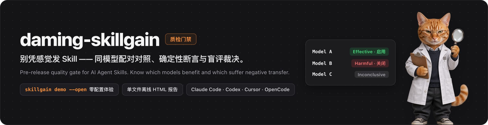
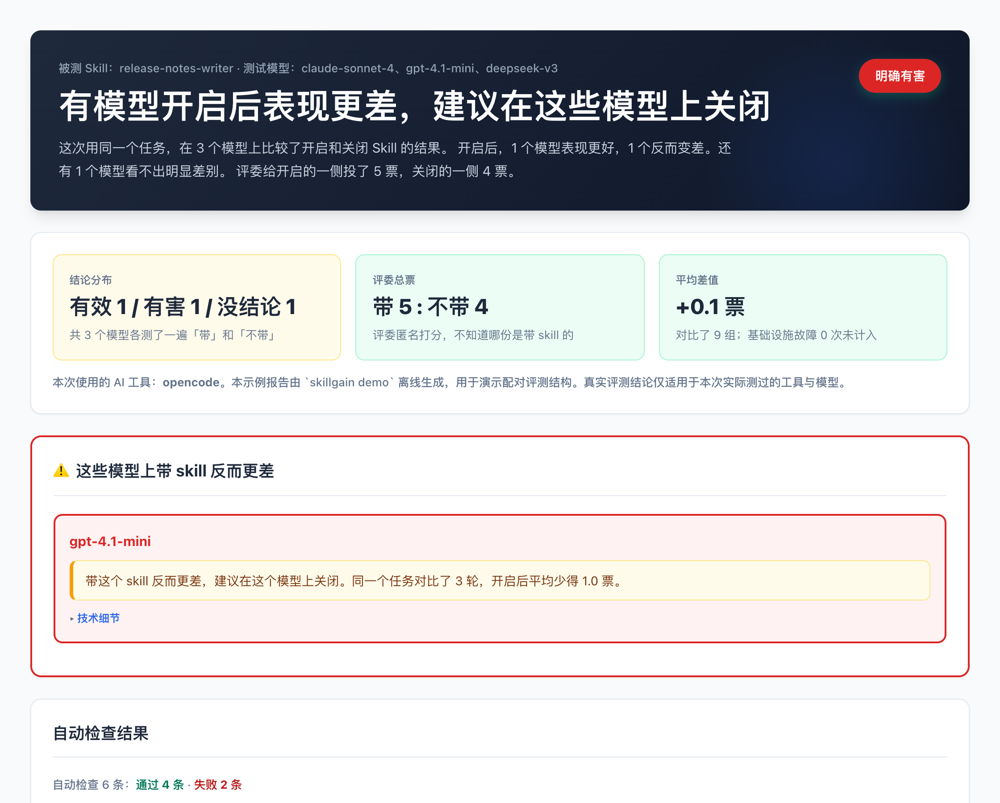
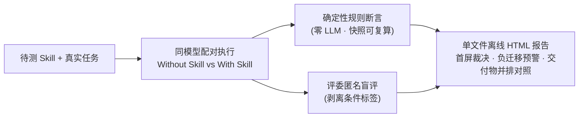

<picture>
  <source media="(prefers-color-scheme: dark)" srcset="assets/banner-dark.png">
  <source media="(prefers-color-scheme: light)" srcset="assets/banner-light.png">
  
</picture>

<div align="center">

<p>
  <a href="README.md"></a>
  <a href="README_EN.md"></a>
  <a href="https://github.com/dylanma8232-art/daming-skillgain/actions/workflows/ci.yml"></a>
  <a href="https://github.com/dylanma8232-art/daming-skillgain/releases/latest"></a>
  <a href="pyproject.toml"></a>
  <a href="LICENSE"></a>
</p>

<p>
  <b>Works with</b>&nbsp;
  
  
  
  
  
</p>

[30 秒快速上手](#30-秒快速上手) · [报告预览](#报告长什么样) · [宿主接入指南](references/hosts.md) · [更新日志](CHANGELOG.md)

</div>

---

写了十几个 `SKILL.md`，怎么确认它真的帮上了忙，而不是在暗中拖后腿？

- **首次发布难自证**：提示词读着很专业，但在真实任务里真的比不挂 Skill 产出更好吗？
- **跨模型负迁移**：在旗舰模型上是神助攻，换到中小模型后反而导致指令混乱、Token 翻倍、结果退化？
- **迭代改版无基准**：微调了几句规则，到底修好了问题，还是把原本稳定的能力改坏了？

**`daming-skillgain`** 是专为 AI Agent Skill 设计的**发布前质检门禁**。它在同一模型、同一真实任务下自动执行 **「带 Skill」与「不带 Skill」配对对照实验**，结合**零 LLM 确定性断言**与**去标签匿名盲评**，生成一份**单文件离线 HTML 报告**——让你用可复核的证据决定发不发、在哪个模型上开、在哪个模型上关。

> 它只做一件事：诚实衡量 Skill 的真实净增益。不替你改写 Skill，也不是笨重的通用大模型跑分平台。

---

## 30 秒快速上手

**在 Agent 或桌面 AI 里使用**：从 [Releases](https://github.com/dylanma8232-art/daming-skillgain/releases/latest) 下载并解压完整 Skill ZIP，在客户端里导入含有 `SKILL.md` 的目录，再说「用 daming-skillgain 给我生成一份示例报告」。客户端需要能读取 Skill 文件并运行本地命令。真正评测其他 Skill 时，还需要至少一个已配置的实验执行工具。见 [Skill 使用说明](SKILL.md)。

### 1. 安装 CLI（注册 `skillgain` 命令）

```bash
pip install git+https://github.com/dylanma8232-art/daming-skillgain.git
```

<details>
<summary>从源码或 Release 压缩包安装</summary>

```bash
git clone https://github.com/dylanma8232-art/daming-skillgain.git
cd daming-skillgain
pip install -e .
```

也可以前往 [Releases](https://github.com/dylanma8232-art/daming-skillgain/releases/latest) 直接下载打包好的 Skill ZIP。

</details>

### 2. 零配置预览真实报告（无需 API Key，1 秒生成）

```bash
skillgain demo --open
```

无需配置任何密钥，立即在本地生成并打开一份包含 **「有效 / 负迁移警报 / 测不出来」** 三种裁决的自包含交互式 HTML 报告。

### 3. 本机体检并启动实测

```bash
skillgain doctor   # 自动检查 Python、依赖、本机已安装的 AI CLI 与密钥状态
skillgain simple   # 问答式引导：回答 4 个问题即可跑完对照并生成 report.html
```

用于 CI 或回归门禁时，可直接传入配置文件免交互运行：

```bash
skillgain pipeline --profile examples/eval-config.example.json
```

---

## 报告长什么样



- **首屏直接给裁决**：不堆统计黑话，首屏直接展示大字结论、核心指标、红绿检查清单与负迁移模型警报。
- **真实交付物并排对照**：直接预览带 Skill 与不带 Skill 产出的实际文件（Markdown、表格、演示稿等），一眼看清差距。
- **单文件 100% 离线自包含**：CSS 与交互逻辑全部内联、零外部请求，直接把 `.html` 发到群里或贴进 PR 即可复核。

---

## 为什么选择 daming-skillgain

| 对比维度 | 手动试跑凭感觉 | 通用 LLM Eval 框架 | **daming-skillgain** |
|---|---|---|---|
| 核心目标 | 只能看单次印象 | 测模型/Prompt 榜单均值 | **专测同一模型下 Skill 的净增益（With vs Without）** |
| 负迁移识别 | 极易漏掉 | 需自行编写统计逻辑 | **自动标红负迁移模型，明确给出关闭建议** |
| 证据不足处理 | 容易硬下结论 | 只给平均分掩盖波动 | **样本不足或置信区间跨 0 时诚实判为「测不出来」** |
| 确定性复核 | 无 | 需自行搭建脚本 | **内置零 LLM 规则断言 + 快照独立复算（`verify-snapshot`）** |
| 报告交付成本 | 聊天截图拼凑 | 需部署 Web 服务 | **单文件离线 HTML，双击即看** |
| Agent 接入成本 | 低但不可复现 | 需写大量 SDK 代码 | **内置主流 CLI 适配器，或 10 行脚本接入任意 Agent** |

---

## 三种诚实裁决与评测流水线

- **Effective（有效）**：配对证据表明启用 Skill 后交付质量显著提升，建议在该模型上开启。
- **Harmful（负迁移 / 有害）**：证据表明启用后产出变差或违规增加，首屏高亮预警，建议在该模型上关闭。
- **Inconclusive（测不出来）**：有效样本不足或任务波动过大，保留不确定性，绝不强行背书。



---

## 支持的 AI 工具与接入方式

被测 AI 工具本身**无需安装任何插件**，统一通过 `HostProtocol` 调度：

| 接入方式 | 支持范围 | 说明 |
|---|---|---|
| **内置原生适配器** | `opencode` / `claude-code` / `codex` / `cursor-agent` | 通过 `--host <name>` 直接指定；运行 `skillgain doctor` 查看本机可用项 |
| **通用脚本契约** | Cursor / Trae / Windsurf / 通义灵码 / 任意 CLI Agent | 仅需 5–10 行包装脚本（见 [`examples/wrapper_template.py`](examples/wrapper_template.py)） |
| **直连模型 API** | `api` / `standalone` / `agent` | 适合纯文本生成任务；涉及文件产出的任务会在预检阶段明确提示 |

除 CLI 外，项目同时提供 **Python SDK**、**REST API（`daming-skillgain[api]`）**、**MCP Server（`daming-skillgain[mcp]`）**，以及可直接安装给 Agent 使用的 [`SKILL.md`](SKILL.md)。完整说明见 [references/usage.md](references/usage.md)。

---

## 可信度与适用边界

- **确定性断言优先**：客观规则检查完全不调用大模型；所有规则与判定结果落盘为快照，随时可通过 `skillgain verify-snapshot` 独立复核。
- **拒绝强行下结论**：配对裁决严格受有效样本数、差值幅度与置信区间门槛约束，不达标一律输出 `Inconclusive`。
- **匿名盲评防偏见**：评委模型只接收剥离了启用/未启用标签的真实产物，原始评语完整留档备查，不冒充绝对真值。
- **结果不跨环境外推**：报告显式记录本次实测的宿主、模型与任务范围；切换宿主或任务类型后应重新评测。

---

## 示例与文档导航

- [`examples/sample-skill/SKILL.md`](examples/sample-skill/SKILL.md) — 开箱即测的示例 Skill
- [`examples/eval-config.example.json`](examples/eval-config.example.json) — 免交互评测配置模板
- [`examples/wrapper_template.py`](examples/wrapper_template.py) — 任意 CLI Agent 包装脚本模板
- [`references/workflow.md`](references/workflow.md) — 分步流水线详解（`plan` → `run` → `evaluate` → `report`）
- [`references/hosts.md`](references/hosts.md) — 宿主能力矩阵与接入说明
- [`references/host-protocol.md`](references/host-protocol.md) — 新增原生宿主适配器开发协议

---

## 关于作者

作者：**[Dylan.ma](https://github.com/dylanma8232-art)** · [查看主页更多开源工具与实验项目 →](https://github.com/dylanma8232-art?tab=repositories)

欢迎提交 Issue 或 PR（见 [CONTRIBUTING.md](CONTRIBUTING.md)）。如果 `daming-skillgain` 帮你拦住过负迁移的 Skill，欢迎点亮右上角 **Star** 支持。

License: [GPL-3.0](LICENSE)
