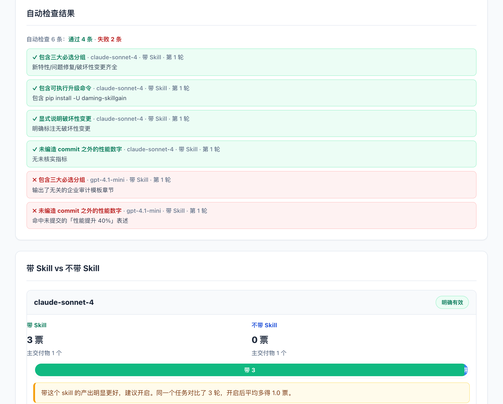
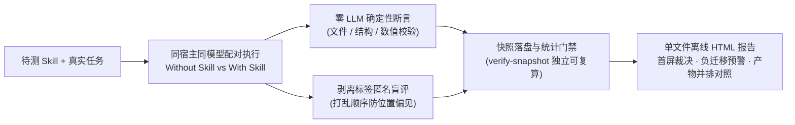

<div align="center">

# 大明 Skill 评测器 (`daming-skillgain`)

**专门用来评测 Skill 的 Skill —— 跑一次真题前后对比，看清你的 Skill 在各模型上是真帮忙还是帮倒忙**

<p>
  <a href="README.md"></a>
  <a href="README_EN.md"></a>
  <a href="https://github.com/dylanma8232-art/daming-skillgain/actions/workflows/ci.yml"></a>
  <a href="https://github.com/dylanma8232-art/daming-skillgain/releases/latest"></a>
  <a href="pyproject.toml"></a>
  <a href="LICENSE"></a>
</p>

<p>
  <b>原生支持与无缝桥接</b>&nbsp;
  
  
  
  
  
  
</p>

[为什么需要它](#为什么需要它) · [30 秒快速上手](#30-秒快速上手) · [真实报告预览](#报告长什么样) · [CLI 命令速查](#cli-命令速查) · [宿主接入指南](references/hosts.md) · [更新日志](CHANGELOG.md)

</div>

---

## 为什么需要它

写完一份或多份 `SKILL.md` 后，团队和个人最容易踩进三个盲区：

- **首次发布难自证**：提示词读起来条理清晰，但在真实复杂任务里，真的比同一个模型「不挂 Skill」表现更好吗？
- **跨模型负迁移隐蔽**：在旗舰大模型上是神助攻，换到高性价比中小模型后反而引发指令冲突、Token 翻倍、产物质量倒退。
- **改版缺乏回归基准**：微调了几条约束，到底是修好了边界问题，还是悄悄把原本稳定的交付改坏了？

**`daming-skillgain`** 是专为 AI Agent Skill 打造的**发布前质检门禁**。它在**同一宿主、同一模型、同一真实任务**下自动运行 **「启用 Skill（With）」与「不启用 Skill（Without）」配对对照实验**，叠加**零 LLM 确定性规则断言**与**剥离条件标签的匿名盲评**，最终生成一份**单文件 100% 离线 HTML 报告**——让你凭可复核证据决定发不发、在哪个模型上开启、在哪个模型上关闭。

> **定位克制而专注**：它只诚实衡量 Skill 的真实净增益，不替你自动改写提示词，也不是笨重的通用大模型跑分榜单。

---

## 30 秒快速上手

### 方式一：直接导入 Agent 客户端使用（零代码）

前往 [Releases](https://github.com/dylanma8232-art/daming-skillgain/releases/latest) 下载并解压完整 Skill 压缩包，在支持本地命令的客户端（如 Claude Code、Codex、OpenCode、Cursor 等）中导入包含 [`SKILL.md`](SKILL.md) 的目录，直接输入：

> 「用 daming-skillgain 给我生成一份示例报告」或「帮我评测一下某某目录下的 Skill」

详细对话工作流说明见 [`SKILL.md`](SKILL.md)。

### 方式二：安装命令行工具（`skillgain`）

```bash
pip install git+https://github.com/dylanma8232-art/daming-skillgain.git
```

<details>
<summary>从源码可编辑安装 / 安装可选扩展（FastAPI、MCP、Anthropic）</summary>

```bash
git clone https://github.com/dylanma8232-art/daming-skillgain.git
cd daming-skillgain
pip install -e .          # 基础 CLI 与核心评测引擎
pip install -e ".[mcp]"   # 可选：启用 MCP Server 支持
pip install -e ".[api]"   # 可选：启用 FastAPI 服务支持
pip install -e ".[all]"   # 安装全部可选扩展
```

</details>

**第 1 步 · 零配置预览真实报告（无需任何 API Key，1 秒生成）**：

```bash
skillgain demo --open
```

立即在本地生成并打开自包含示例报告，直观体验 **「明确有效 / 负迁移警报 / 测不出来」** 三种完整裁决与真实产物并排对照。

**第 2 步 · 本机环境体检与 4 问引导实测**：

```bash
skillgain doctor   # 自动检测 Python、依赖、本机已安装的 AI CLI 与密钥就绪状态
skillgain simple   # 交互式回答 4 个问题（被测 Skill / 任务 / 被测模型 / 评委模型），自动跑完并输出 report.html
```

**第 3 步 · 免交互配置文件运行（适合 CI 与日常回归门禁）**：

```bash
skillgain pipeline --profile examples/eval-config.example.json
```

---

## 报告长什么样

<table>
<tr>
<td width="50%" valign="top">
  
  <br>
  <sub><b>首屏结论与负迁移预警（真实报告直截）</b>：一眼看清有效/有害/没结论模型分布，自动标红开启后表现倒退的模型</sub>
</td>
<td width="50%" valign="top">
  
  <br>
  <sub><b>自动规则检查与配对盲评明细</b>：逐条列出零 LLM 确定性断言通过/失败原因，并展示各模型带与不带 Skill 的得票对照</sub>
</td>
</tr>
</table>

- **首屏直给通俗裁决**：拒绝晦涩统计术语，首屏直接展示一句话结论、有效/有害模型分布、负迁移红色预警框与下一步操作建议。
- **客观断言 + 盲评双轨存证**：逐条展示零 LLM 自动规则检查通过率（如文件是否生成、结构/表格/预算是否合规），并附上匿名盲评票数与理由。
- **真实交付物并排复核**：直接在页面内并排展开「带 Skill」与「不带 Skill」产出的真实文件内容，好在哪、坏在哪一目了然。
- **单文件离线自包含**：CSS 与交互逻辑全部内联、无任何外链依赖，生成的单个 `.html` 文件可直接发进飞书/微信群或挂入 PR 归档。

---

## 三种诚实裁决与评测流水线

| 裁决结论 | 触发条件 | 行动建议 |
|---|---|---|
| **Effective（明确有效）** | 配对重复实验与客观断言/盲评一致表明启用 Skill 后质量稳定提升 | 放心在该模型上启用并发布 |
| **Harmful（负迁移警报）** | 启用 Skill 后客观规则违约增加或交付质量显著倒退 | 首屏高亮标红，**建议在该模型上关闭**或针对性裁剪指令 |
| **Inconclusive（测不出来）** | 有效配对样本不足，或得分差值置信区间跨 0、波动过大 | 诚实保留不确定性，绝不强行背书，建议补充样本重测 |



---

## 为什么不用手动试跑或通用跑分框架？

| 对比维度 | 手动试跑凭感觉 | 通用 LLM Eval 框架 | **daming-skillgain** |
|---|---|---|---|
| **核心问题** | 单次主观印象，无法复现 | 测裸模型或静态 Prompt 榜单均值 | **专测同一模型挂载 Skill 前后的真实净增益** |
| **跨模型负迁移识别** | 极易漏看中小模型退化 | 需自行编写配对统计逻辑 | **自动按模型分拆，标红负迁移模型并提示关闭** |
| **小样本波动处理** | 容易看一次赢就拍板上线 | 只算平均分，掩盖随机波动 | **置信区间或样本量不达标一律诚实判为 `Inconclusive`** |
| **客观复核成本** | 无留档 | 需自建校验管线与看板服务 | **内置零 LLM 断言 + 快照复算 + 单文件离线 HTML** |
| **真实 Agent 接入** | 手动复制粘贴 | 往往只能跑纯文本 API | **原生调度 Claude Code / Codex / OpenCode / Cursor 真实干活** |

---

## CLI 命令速查

| 命令 | 适用场景 | 说明 |
|---|---|---|
| `skillgain demo [--open]` | 初次体验 | 无需 API Key，1 秒生成包含三种典型裁决的离线交互报告 |
| `skillgain doctor` | 开跑前自检 | 检查 Python 环境、依赖包、本机可用 AI CLI 与模型凭据状态 |
| `skillgain simple` | 日常快速评测 | 4 问交互引导，自动串联 `plan → run → evaluate → report` |
| `skillgain pipeline --profile <json>` | 回归门禁 / CI | 读取配置模板免交互一键跑完全流程 |
| `skillgain plan / run / evaluate / report` | 高级分步控制 | 分阶段生成评测计划、执行配对采样、重跑评估或重出报告 |
| `skillgain verify-snapshot <dir>` | 审计独立复核 | 完全脱离大模型，对已落盘实验快照重新校验确定性断言与统计结论 |

---

## 支持的宿主与集成接口

被测 AI 工具本身**无需安装任何插件**，统一通过 `HostProtocol` 无侵入调度：

| 接入层 | 支持范围 | 接入方式 |
|---|---|---|
| **内置原生 CLI 适配器** | `opencode` / `claude-code` / `codex` / `cursor-agent` | `--host <name>` 直接指定；运行 `skillgain doctor` 自动探测 |
| **通用脚本契约** | Cursor / Trae / Windsurf / 通义灵码 / 自研 CLI Agent | 仅需约 10 行包装脚本（模板见 [`examples/wrapper_template.py`](examples/wrapper_template.py)） |
| **直连模型接口** | OpenAI 兼容接口 / Anthropic SDK | 适合纯文本生成类 Skill；涉及文件落盘的任务会在预检阶段主动提醒 |
| **服务端与协议集成** | Python SDK / FastAPI (`[api]`) / MCP Server (`[mcp]`) | 可直接挂载进内部研发平台或作为 MCP 工具供桌面 Agent 调用 |

---

## 可信度保障与适用边界

1. **确定性断言优先于大模型打分**：文件存在性、格式合法性、必填字段与数值约束完全由确定性规则判定，不消耗 Token 且零幻觉。
2. **匿名双盲防偏见**：送交评委模型的两份产物均剥离 `With / Without` 条件标签并随机交换顺序，原始评语全量留档备查。
3. **结论严格限定实测范围**：报告显式记录本次测试的宿主、模型版本、任务输入与重复次数，不做跨环境过度外推。

---

## 文档导航

- [`SKILL.md`](SKILL.md) — 作为 Agent Skill 被客户端直接调用时的完整规范
- [`examples/sample-skill/SKILL.md`](examples/sample-skill/SKILL.md) — 开箱即测的示例 Skill
- [`examples/eval-config.example.json`](examples/eval-config.example.json) — 免交互评测配置模板
- [`examples/wrapper_template.py`](examples/wrapper_template.py) — 任意 CLI Agent 10 行包装脚本模板
- [`references/usage.md`](references/usage.md) — CLI、Python SDK、REST API 与 MCP Server 完整手册
- [`references/workflow.md`](references/workflow.md) — 四阶段流水线与快照结构详解
- [`references/hosts.md`](references/hosts.md) & [`references/host-protocol.md`](references/host-protocol.md) — 宿主能力矩阵与自定义适配器协议

---

## 关于作者

作者：**[Dylan.ma](https://github.com/dylanma8232-art)** · **[返回个人主页查看更多开源项目 →](https://github.com/dylanma8232-art)**

欢迎提交 Issue 或 PR（见 [CONTRIBUTING.md](CONTRIBUTING.md)）。如果 `daming-skillgain` 帮你在发布前拦住过负迁移的 Skill，欢迎点亮右上角 **Star** 支持。

开源协议：[GPL-3.0](LICENSE)
