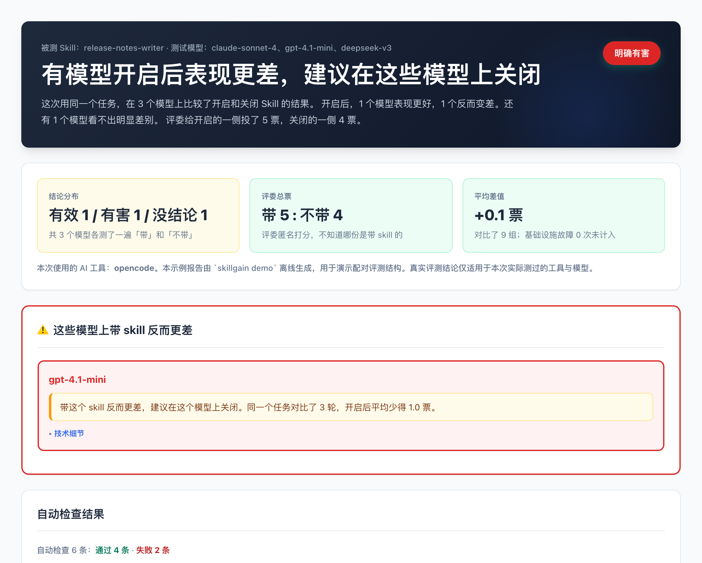
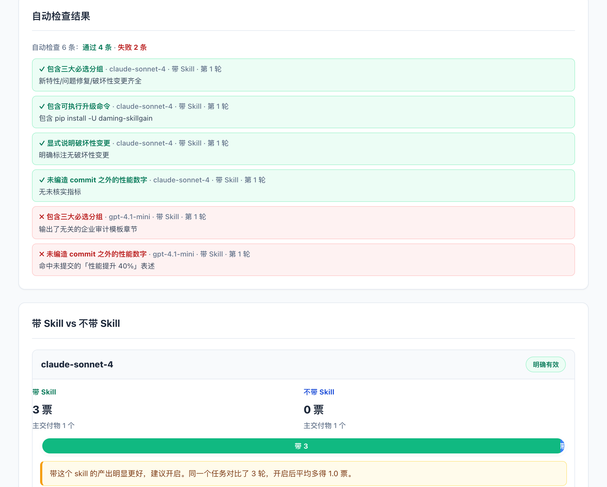
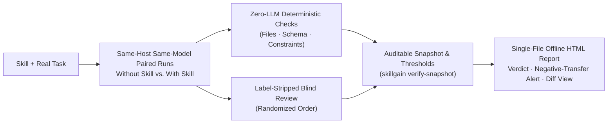

<div align="center">

# daming-skillgain

**Pre-release quality gate for AI Agent Skills — replace gut feeling with paired experiments, deterministic checks, and blind review**

<p>
  <a href="README.md"></a>
  <a href="README_EN.md"></a>
  <a href="https://github.com/dylanma8232-art/daming-skillgain/actions/workflows/ci.yml"></a>
  <a href="https://github.com/dylanma8232-art/daming-skillgain/releases/latest"></a>
  <a href="pyproject.toml"></a>
  <a href="LICENSE"></a>
</p>

<p>
  <b>Works natively with</b>&nbsp;
  
  
  
  
  
  
</p>

[Why daming-skillgain](#why-daming-skillgain) · [30-Second Quickstart](#30-second-quickstart) · [Report Preview](#what-the-report-looks-like) · [CLI Reference](#cli-reference) · [Host Integrations](references/hosts.md) · [Changelog](CHANGELOG.md)

</div>

---

## Why daming-skillgain

Writing `SKILL.md` files is easy; proving they actually improve real deliverables without breaking smaller models is hard:

- **Unverified first releases**: Instructions may read well, yet do they measurably outperform the exact same model *without* the Skill on real tasks?
- **Hidden cross-model negative transfer**: A Skill that boosts a frontier model often confuses mid-tier models, inflates token usage, and degrades output quality.
- **Blind prompt edits**: Tweaking rules without a paired baseline makes it impossible to tell whether an update fixed edge cases or introduced regressions.

**`daming-skillgain`** is a dedicated **pre-release quality gate for AI Agent Skills**. It runs paired **with-Skill vs. without-Skill** experiments on the exact same host, model, and real task, combines **zero-LLM deterministic assertions** with **label-stripped blind reviews**, and writes a **single-file 100% offline HTML report** — giving you reproducible evidence on whether to ship a Skill and which models should keep it enabled or disabled.

---

## 30-Second Quickstart

### Option A: Import Directly into Your Desktop / CLI Agent

Download and extract the packaged Skill ZIP from [Releases](https://github.com/dylanma8232-art/daming-skillgain/releases/latest), import the folder containing [`SKILL.md`](SKILL.md) into your agent client (Claude Code, Codex, OpenCode, Cursor, etc.), and ask:

> *"Use daming-skillgain to generate a demo report"* or *"Evaluate the Skill in `./my-skill`"*

See [`SKILL.md`](SKILL.md) for agent-driven usage details.

### Option B: Install the `skillgain` CLI

```bash
pip install git+https://github.com/dylanma8232-art/daming-skillgain.git
```

<details>
<summary>Editable source install & optional extras (MCP, FastAPI, Anthropic)</summary>

```bash
git clone https://github.com/dylanma8232-art/daming-skillgain.git
cd daming-skillgain
pip install -e .          # Core CLI & evaluation engine
pip install -e ".[mcp]"   # Optional MCP Server support
pip install -e ".[api]"   # Optional FastAPI server support
pip install -e ".[all]"   # Install all optional integrations
```

</details>

**Step 1 · Preview a real report instantly (zero API keys, < 1 second)**:

```bash
skillgain demo --open
```

Generates and opens a self-contained interactive report demonstrating all three verdicts (**Effective**, **Harmful / Negative Transfer**, and **Inconclusive**) alongside side-by-side deliverables.

**Step 2 · Check local readiness & launch the guided 4-question wizard**:

```bash
skillgain doctor   # Inspects Python, dependencies, installed AI CLIs, and API credentials
skillgain simple   # Answer 4 questions -> runs paired experiments and outputs report.html
```

**Step 3 · Run non-interactively in CI or regression pipelines**:

```bash
skillgain pipeline --profile examples/eval-config.example.json
```

---

## What the Report Looks Like

<table>
<tr>
<td width="50%" valign="top">
  
  <br>
  <sub><b>Top-of-Report Verdict & Negative-Transfer Alert</b>: Direct screenshot from <code>skillgain demo</code> showing per-model outcomes and red alerts where enabling the Skill hurts performance</sub>
</td>
<td width="50%" valign="top">
  
  <br>
  <sub><b>Deterministic Rule Checks & Paired Blind Votes</b>: Zero-LLM pass/fail assertions alongside per-model with-Skill vs. without-Skill blind review scores</sub>
</td>
</tr>
</table>

- **Decision-first summary**: Plain-language headline, per-model breakdown, and high-visibility red alerts for models suffering negative transfer.
- **Deterministic checks + blind review**: Zero-LLM rule pass/fail checklists paired with anonymized judge votes and preserved rationales.
- **Side-by-side deliverables**: Inspect actual artifacts generated with and without the Skill directly inside the page.
- **100% offline single file**: All CSS and scripts are inlined with zero external requests — share the `.html` file directly in PRs, Slack, or email.

---

## Three Honest Verdicts & Evaluation Pipeline

| Verdict | Criteria | Recommended Action |
|---|---|---|
| **Effective** | Paired runs, deterministic checks, and blind review consistently show improved output | Safe to enable and ship on that model |
| **Harmful (Negative Transfer)** | Enabling the Skill increases rule violations or degrades deliverable quality | Highlighted on the first screen — **disable on that model** or trim instructions |
| **Inconclusive** | Sample size is insufficient or confidence intervals cross zero due to task variance | Uncertainty stays explicit instead of forcing a false positive |



---

## CLI Reference

| Command | Use Case | Description |
|---|---|---|
| `skillgain demo [--open]` | Zero-setup tour | Generates an offline interactive sample report in < 1s without API keys |
| `skillgain doctor` | Preflight diagnostics | Checks Python, packages, detected local AI CLIs, and credential readiness |
| `skillgain simple` | Everyday evaluation | 4-question wizard chaining `plan → run → evaluate → report` |
| `skillgain pipeline --profile <json>` | CI / Regression gate | Non-interactive end-to-end execution from a JSON profile |
| `skillgain plan / run / evaluate / report` | Granular control | Run individual pipeline stages or re-render reports from existing runs |
| `skillgain verify-snapshot <dir>` | Offline audit | Re-verifies deterministic assertions and verdict math from saved snapshots with zero LLM calls |

---

## Supported Hosts & Interfaces

The agent under test requires **zero plugins** — everything dispatches cleanly via `HostProtocol`:

| Layer | Supported Targets | How It Connects |
|---|---|---|
| **Built-in CLI Adapters** | `opencode`, `claude-code`, `codex`, `cursor-agent` | Pass `--host <name>`; auto-detected by `skillgain doctor` |
| **Universal Script Contract** | Cursor, Trae, Windsurf, Cline, or any custom CLI agent | ~10-line wrapper script (see [`examples/wrapper_template.py`](examples/wrapper_template.py)) |
| **Direct Model API** | OpenAI-compatible endpoints & Anthropic SDK | Best for text-only tasks; file-producing tasks trigger preflight warnings |
| **Service & Tool Protocols** | Python SDK, FastAPI (`[api]`), MCP Server (`[mcp]`) | Embed into internal CI dashboards or expose as an MCP tool |

---

## Documentation

- [`SKILL.md`](SKILL.md) — Instructions when invoked directly as an Agent Skill
- [`examples/sample-skill/SKILL.md`](examples/sample-skill/SKILL.md) — Ready-to-evaluate sample Skill
- [`examples/eval-config.example.json`](examples/eval-config.example.json) — Non-interactive evaluation profile template
- [`examples/wrapper_template.py`](examples/wrapper_template.py) — Universal wrapper template for any CLI agent
- [`references/usage.md`](references/usage.md) — Full CLI, Python SDK, REST API, and MCP Server guide
- [`references/workflow.md`](references/workflow.md) — 4-stage pipeline & snapshot specification
- [`references/hosts.md`](references/hosts.md) & [`references/host-protocol.md`](references/host-protocol.md) — Host capability matrix & adapter protocol

---

## Author

Built by **[Dylan.ma](https://github.com/dylanma8232-art)** · **[Visit profile for more open-source projects →](https://github.com/dylanma8232-art)**

Contributions and evaluation stories are welcome — see [CONTRIBUTING.md](CONTRIBUTING.md). If `daming-skillgain` helped you catch negative transfer before shipping, consider giving it a **Star**.

License: [GPL-3.0](LICENSE)
