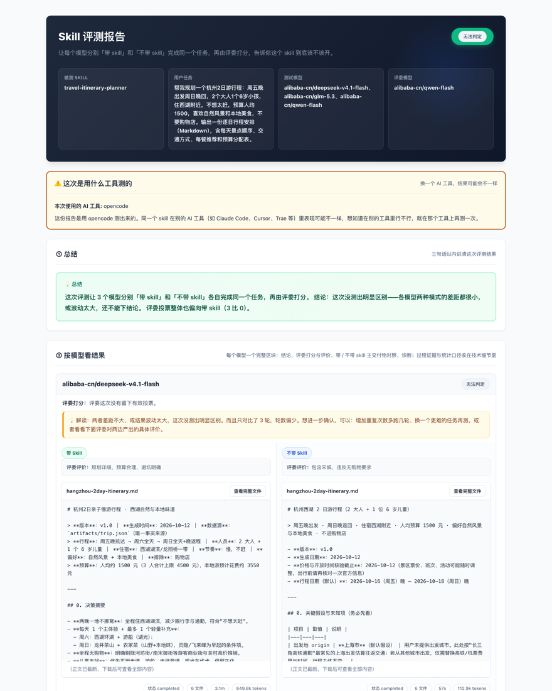

**[中文](README.md)** | English

[](https://github.com/dylanma8232-art/daming-skillgain/releases/latest)

# Daming Skill Gain Evaluation

You have written several Skills, but cannot tell which ones actually help. A Skill may help one model and get in another's way. After an edit, it is just as hard to know whether the change improved the work or made it worse.

This project is a **pre-release quality gate for Skills**. Run a real task with and without a Skill, compare the deliverables, then decide whether to publish it and which models should have it enabled. It measures a Skill's effect; it is not a general-purpose eval framework and does not rewrite or optimize Skill text.

## Three release questions

1. **Does a Skill help on its first release?** Run the same task with one model in both conditions. Compare the deliverables, deterministic checks, and anonymous reviews before deciding whether to publish.
2. **Does it behave differently across models?** Review paired results per model to see where the Skill helps or may cause harm. A result from one model should not stand in for every model.
3. **Did an edit improve the Skill?** Rerun the same task and inputs with the revised version. Compare both sets of deliverables, check results, and review evidence before adopting the change.

## Three possible verdicts

- **Effective:** evidence supports better results with the Skill; consider enabling it for that model.
- **Harmful:** evidence supports worse results; consider disabling it for that model.
- **Inconclusive:** evidence is insufficient or the difference is unclear. Keep the uncertainty visible and gather more evidence.

```text
Prepare a Skill, a real task, and any required inputs
                         │
Choose the tool, models, and anonymous judges
                         │
Run the same task with the Skill off and on
                         │
Apply deterministic checks; judges compare actual deliverables anonymously
                         │
Review verdicts, side-by-side outputs, and run evidence before release
```

## Download

Get the latest Skill package from the Releases page:

[](https://github.com/dylanma8232-art/daming-skillgain/releases/latest)

```bash
unzip daming-skillgain-v*.zip
cd daming-skillgain
pip install -r requirements.txt
python3 -m evaluator.cli simple
```

## Get started in 30 seconds (from source)

Requires Python 3 and the project dependencies. The tool under test must also run on your machine. You can also clone the repository, install dependencies, and start the guided evaluation:

```bash
git clone https://github.com/dylanma8232-art/daming-skillgain.git
cd daming-skillgain
pip install -r requirements.txt
python3 -m evaluator.cli simple
```

Follow the prompts to choose a Skill, task, test models, and judges. Open the generated `report.html` when the run finishes.



The summary gives the verdict; per-model results and side-by-side deliverables show what changed and why, helping you decide whether to enable the Skill for that model.

## Evidence and limits

- Built-in deterministic checks evaluate configured rules without calling an LLM. Rules and results are saved in a snapshot for review. The same inputs, rules, and judgment version reproduce the same rule-based verdict.
- Paired verdicts use valid results, score differences, confidence intervals, and evidence thresholds. When evidence falls short, the result stays “Inconclusive” instead of forcing a call.
- Anonymous judges compare deliverables without condition labels. Their reviews are one source of evidence, not objective ground truth. Model outputs and reviews can vary, so the full evaluation does use LLMs.
- Reports retain check snapshots, raw judge feedback, run records, and deliverables so you can trace the decision. Results apply to the task, models, tool, and inputs used in that run.

## Supported integrations

| Integration | When to use it |
|---|---|
| Built-in adapter | A supported command-line tool runs locally; select it with `--host`. |
| Script adapter | A wrapper can invoke the tool and write files in the working directory. |
| Model API | Call a model service directly; check that the executor supports the task's file needs. |

## FAQ

**Do results generalize to every task and model?** No. They apply to the task, models, tool, and inputs in that run. Retest when those conditions change.

**Do judges define the right answer?** No. You set the task goal. Configured deterministic rules check specified requirements, while judges compare the deliverables.

**Can I use it commercially?** Yes. The project uses GPL-3.0; distributed or modified versions must follow that license.

License: [GPL-3.0](LICENSE)
