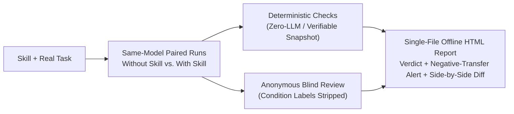

<div align="center">

# daming-skillgain

**Don't ship AI Agent Skills on vibes — add a reproducible pre-release quality gate.**

[](https://github.com/dylanma8232-art/daming-skillgain/actions/workflows/ci.yml)
[](https://github.com/dylanma8232-art/daming-skillgain/releases/latest)
[](pyproject.toml)
[](LICENSE)
[](CONTRIBUTING.md)

[中文](README.md) | **English** · [30-Second Demo](#-30-second-quickstart) · [Host Integrations](references/hosts.md) · [Changelog](CHANGELOG.md)

</div>

---

You have written a dozen `SKILL.md` files — but do they actually make your AI agent better?

- **First release**: It reads great, yet does it measurably beat the same model *without* the Skill?
- **Cross-model regression**: A Skill that helps Claude can trigger **negative transfer** (worse output + 2x tokens) on smaller models.
- **After an edit**: Did your latest tweak improve real deliverables, or quietly degrade them?

**`daming-skillgain`** is a **pre-release quality gate for Skills**. It runs paired **with-Skill vs. without-Skill** experiments on the same model and real task, combines **deterministic checks** with **blind judge reviews**, and produces a **single-file offline HTML report** so you can decide with evidence whether to ship it — and which models should have it on or off.

> Focused strictly on measuring real Skill gain: it does not rewrite your Skill and is not a bloated general-purpose eval platform.

---

## ⚡ 30-Second Quickstart

### 1. Install (adds the `skillgain` CLI)

```bash
pip install git+https://github.com/dylanma8232-art/daming-skillgain.git
```

<details>
<summary>Or install from source / Release ZIP</summary>

```bash
git clone https://github.com/dylanma8232-art/daming-skillgain.git
cd daming-skillgain
pip install -e .
```

Pre-packaged Skill bundles are also available on the [Releases](https://github.com/dylanma8232-art/daming-skillgain/releases/latest) page.

</details>

### 2. Try an instant offline report (zero API keys, < 1 second)

```bash
skillgain demo --open
```

Generates a realistic, self-contained HTML report demonstrating all three verdicts (**Effective**, **Harmful / Negative Transfer**, and **Inconclusive**) with zero configuration.

### 3. Check your local environment & run a real evaluation

```bash
skillgain doctor   # Inspect Python, deps, detected AI CLIs, and API key status
skillgain simple   # Guided 4-question flow -> generates report.html
```

Or run non-interactively from a reusable profile (great for CI and regression checks):

```bash
skillgain pipeline --profile examples/eval-config.example.json
```

---

## 🎯 Why daming-skillgain?

| Dimension | Manual spot-checks | Generic LLM eval frameworks | **daming-skillgain** |
|---|---|---|---|
| Core focus | Gut feeling | Model / prompt leaderboards | **Paired Skill gain (With vs. Without)** |
| Negative transfer | Easily missed | Build your own stats | **Explicit red alert telling you which models to turn off** |
| Uncertainty | Forces a guess | Averages hide noise | **Reports "Inconclusive" when evidence falls short** |
| Reproducibility | Low | Custom plumbing | **Zero-LLM deterministic assertions + verifiable snapshots** |
| Report sharing | Chat screenshots | Requires web server | **Single-file offline HTML (zero external CDN links)** |
| Setup effort | Unrepeatable | Heavy SDK / dataset code | **4-step wizard or 10-line wrapper script for any agent** |

---

## 🧭 Three Honest Verdicts & Workflow

- ✅ **Effective**: Evidence supports better deliverables with the Skill; safe to enable on that model.
- 🚨 **Harmful (Negative Transfer)**: Evidence shows worse results; highlighted on the first screen so you disable it on that model.
- ⚖️ **Inconclusive**: Sample size is too small or variance is too high; uncertainty stays explicit instead of forcing a call.



---

## 📊 What the Report Looks Like


- **Decision-first layout**: Verdict headline, key metrics, pass/fail check list, and negative-transfer alerts right at the top.
- **Side-by-side deliverables**: Preview real outputs produced with and without the Skill (Markdown, spreadsheets, slides, etc.).
- **100% self-contained**: Inline CSS & JS with zero external requests — share the single `.html` file anywhere.

---

## 🔌 Supported AI Tools & Interfaces

The AI tool under test needs **no extra plugins**. Everything runs through a unified `HostProtocol`:

| Integration | Supported Tools | Notes |
|---|---|---|
| **Built-in Adapters** | `opencode`, `claude-code`, `codex`, `cursor-agent` | Select with `--host <name>`; run `skillgain doctor` to see what's ready locally |
| **Universal Script Adapter** | Cursor, Trae, Windsurf, Cline, or any CLI agent | Wrap any command in ~10 lines (see [`examples/wrapper_template.py`](examples/wrapper_template.py)) |
| **Direct Model API** | `api`, `standalone`, `agent` | For text-only tasks; file-producing tasks are flagged explicitly during preflight |

Also ships with a **Python SDK**, **REST API (`daming-skillgain[api]`)**, **MCP Server (`daming-skillgain[mcp]`)**, and a ready-to-install [`SKILL.md`](SKILL.md). See [references/usage.md](references/usage.md).

---

## 🛡️ Evidence & Boundaries

- **Deterministic checks first**: Built-in rule assertions never call an LLM; rules and results are snapshotted and independently verifiable via `skillgain verify-snapshot`.
- **No forced verdicts**: Paired verdicts enforce valid-sample, delta, and confidence thresholds; insufficient evidence stays `Inconclusive`.
- **Blind review as evidence, not ground truth**: Judges compare anonymized deliverables and raw feedback is preserved for audit.
- **No cross-host extrapolation**: Reports explicitly state which host, models, and task were tested.

---

## 📁 Examples & Documentation

- [`examples/sample-skill/SKILL.md`](examples/sample-skill/SKILL.md) — Ready-to-test sample Skill
- [`examples/eval-config.example.json`](examples/eval-config.example.json) — Non-interactive evaluation profile template
- [`examples/wrapper_template.py`](examples/wrapper_template.py) — Universal script adapter for any CLI agent
- [`references/workflow.md`](references/workflow.md) — Step-by-step pipeline (`plan` → `run` → `evaluate` → `report`)
- [`references/hosts.md`](references/hosts.md) — Host capability matrix & integration guide
- [`references/host-protocol.md`](references/host-protocol.md) — Implementing a new native host adapter

---

## 🤝 Contributing

Issues, real-world Skill evaluation stories, and new host adapter PRs are warmly welcome! See [CONTRIBUTING.md](CONTRIBUTING.md).

If `daming-skillgain` helped you catch a Skill causing negative transfer before shipping, consider giving it a **⭐ Star**!

---

License: [GPL-3.0](LICENSE)
